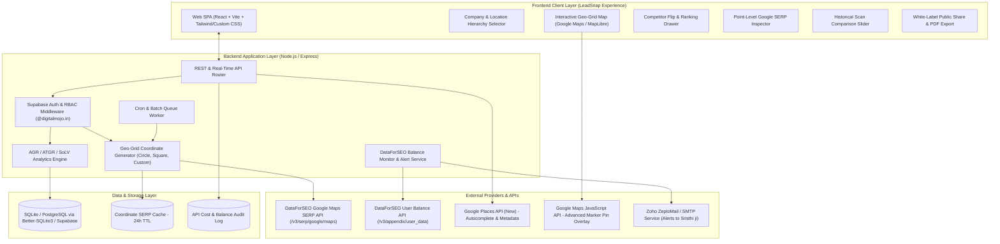

# LeadSnap Heat Map — Reverse Engineered System Architecture (REA)

**Target Product:** [LeadSnap App](https://app.leadsnap.com/)  
**Document:** System Architecture & Technical Decomposition  
**Author:** Antigravity Engineering Architecture Team  
**Date:** November 2026  

---

## 1. Executive Summary & Product Objective

LeadSnap is a dominant SaaS platform in local SEO, GBP (Google Business Profile) management, and agency client acquisition. Its primary retention and utility driver is the **GBP Geo-Grid Heat Map**, which provides block-by-block visual ranking intelligence across local service areas.

The internal Digital Mojo team is accustomed to LeadSnap's exact user experience, workflows, layout density, and metrics terminology. The objective of this project is to architect and deliver **MojoMap** with 1:1 functional, visual, and operational parity to LeadSnap's Heat Map module, backed by **DataForSEO** Google Maps SERP APIs, enhanced with an automated low-balance alert for Sristhi ji with direct payment top-up links.

---

## 2. High-Level System Architecture Diagram

---

## 3. Core Architectural Subsystems

### 3.1 Multi-Tenant Hierarchy Model
LeadSnap groups data into a strict 4-level hierarchy:
1. **Agency / Workspace:** Top-level account (`Digital Mojo`).
2. **Company / Client:** The client brand or business entity (e.g., `Apex Roofing`, `Nexus Studios`).
3. **Location (GBP):** The physical address or Service Area Business (SAB) listing tied to a Google `place_id`, coordinates, phone, and category.
4. **Keyword Scans & Timelines:** A recurring or one-off geo-grid scan tied to a specific keyword, grid configuration, and historical timestamps.

### 3.2 Geo-Grid Coordinate Generator
LeadSnap provides 3 primary grid topologies:
- **Square Grid:** $N \times N$ matrix (e.g., $3 \times 3 = 9$, $5 \times 5 = 25$, $7 \times 7 = 49$, $9 \times 9 = 81$, $13 \times 13 = 169$, $15 \times 15 = 225$).
- **Circle Grid:** Concentric ring radius filter inscribed inside an $N \times N$ matrix (e.g., $9 \times 9$ circle yields 61 points; $7 \times 7$ circle yields 37 points), eliminating wasteful corner coordinates.
- **Spacing / Radius Mode:**
  - *Distance Between Points:* Step size in miles or kilometers (e.g., `0.5 mi`, `1.0 mi`, `2.5 mi`, `5.0 mi`).
  - *Total Radius:* Total diameter from center pin, where step size is auto-calculated as $\text{Radius} / (\lfloor N/2 \rfloor)$.

### 3.3 SERP Execution & Extraction Pipeline (DataForSEO)
LeadSnap executes queries against local Google Maps endpoints:
1. **Coordinate Injection:** For each point $(lat_i, lng_i)$, a live SERP task is dispatched with coordinate bounds or `@lat,lng,zoom` context.
2. **Top 20 Extractions:** DataForSEO returns the local 20 pack entries containing:
   - Rank Position (`1` to `20`)
   - Business Title (`title`)
   - Google `place_id` and `cid`
   - Primary category / additional categories
   - Rating (`rating.value`) & Review Count (`rating.votes_count`)
   - Address, Phone, Website, Photos count
3. **Deduplication & Matching:** The target business is matched via `place_id` (primary) or fuzzy name + address matching (fallback). If not found in the top 20, rank is assigned `null` (displayed as `20+`).

### 3.4 Metrics Computation Engine
LeadSnap surfaces 4 industry-standard local ranking metrics:
1. **AGR (Average Grid Rank):**
   $$\text{AGR} = \frac{\sum_{p \in \text{RankedPoints}} \text{Rank}(p)}{|\text{RankedPoints}|}$$
   *Only computes coordinates where the business ranks between 1 and 20.*
2. **ATGR (Average Total Grid Rank):**
   $$\text{ATGR} = \frac{\sum_{p \in \text{AllPoints}} (\text{Rank}(p) \text{ if ranked else } 21)}{|\text{AllPoints}|}$$
   *Penalizes blind spots by assigning rank 21 to every point outside the top 20.*
3. **SoLV (Share of Local Voice) / Top 3 Pack Dominance:**
   $$\text{SoLV}_{\text{Top3}} = \frac{|\{p \in \text{AllPoints} \mid \text{Rank}(p) \le 3\}|}{|\text{AllPoints}|} \times 100\%$$
   *Measures high-intent conversion real estate.*
4. **Top 10 Pack Share:**
   $$\text{Share}_{\text{Top10}} = \frac{|\{p \in \text{AllPoints} \mid \text{Rank}(p) \le 10\}|}{|\text{AllPoints}|} \times 100\%$$

### 3.5 Competitor Flipping Engine ("Flip the Grid")
In LeadSnap, every scan automatically aggregates all competitors discovered across all grid coordinates:
- The system indexes every unique competitor's `place_id`.
- For any competitor selected in the leaderboard, the frontend **flips** the pins dynamically: every grid point displays *that* competitor's ranking position without re-running API queries or spending additional credits!
- Recalculates AGR, ATGR, and Top 3 Share for that competitor across the exact same geographic grid.

### 3.6 Timeline & Progress Tracking
- Stores historical scans per keyword and location.
- Provides a scrubber/slider showing the migration of rank pins from red to yellow to green over weekly/monthly optimization cycles.
- Generates side-by-side delta comparisons (e.g., Scan Date A vs Scan Date B: $+3$, $-1$, `NEW`).

---

## 4. DataForSEO Low Balance Watchdog & Automated Alerts

To safeguard against scan interruptions:
1. **Background Polling:** Periodic automated cron job (`0 */4 * * *`) calls `GET https://api.dataforseo.com/v3/appendix/user_data` (zero-cost API).
2. **Balance Evaluation:** Checks `money.balance`.
3. **Threshold Guard:** If `money.balance < THRESHOLD_USD` (configurable, default `$15.00`):
   - Dispatches a transactional email to **Sristhi ji** (`sristhi@digitalmojo.in` or configured address) via Zoho ZeptoMail.
   - Includes current live balance, estimated remaining scans, and a direct button to the DataForSEO Top-Up Payment page: `https://app.dataforseo.com/financial/balance`.
   - Sets a 24-hour alert debounce flag so Sristhi ji is not spammed every hour while replenishment is pending.
