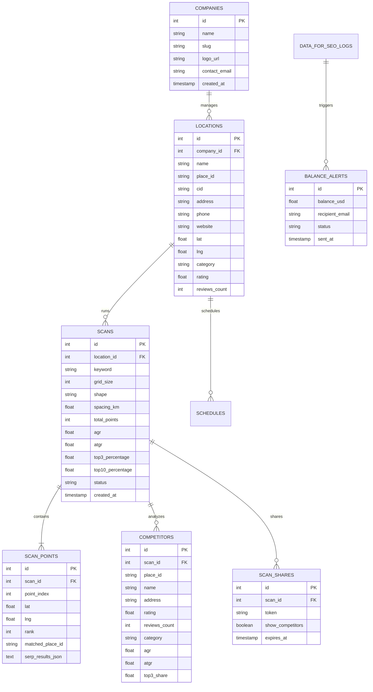

# LeadSnap Parity — Data Models & Database Schema

This document details the reverse-engineered database schema required to support LeadSnap-identical organization hierarchies, multi-location management, geo-grid caching, competitor flips, and balance alerts.

---

## 1. Entity Relationship Overview



---

## 2. Table Specifications (SQL)

### 2.1 Companies / Clients (`companies`)
Supports grouping multiple locations/GBPs under one brand name (LeadSnap client directory):
```sql
CREATE TABLE IF NOT EXISTS companies (
  id            INTEGER PRIMARY KEY AUTOINCREMENT,
  name          TEXT    NOT NULL,
  slug          TEXT    UNIQUE NOT NULL,
  logo_url      TEXT,
  website       TEXT,
  contact_email TEXT,
  created_at    INTEGER NOT NULL DEFAULT (unixepoch())
);
```

### 2.2 Locations / GBP Profiles (`businesses` / `locations`)
```sql
CREATE TABLE IF NOT EXISTS locations (
  id             INTEGER PRIMARY KEY AUTOINCREMENT,
  company_id     INTEGER REFERENCES companies(id) ON DELETE SET NULL,
  name           TEXT    NOT NULL,
  place_id       TEXT,
  cid            TEXT,
  address        TEXT,
  phone          TEXT,
  website        TEXT,
  lat            REAL    NOT NULL,
  lng            REAL    NOT NULL,
  category       TEXT,
  rating         REAL    DEFAULT 0,
  reviews_count  INTEGER DEFAULT 0,
  created_at     INTEGER NOT NULL DEFAULT (unixepoch())
);
```

### 2.3 Scans (`scans`)
Enriched with LeadSnap's four primary visibility metrics:
```sql
CREATE TABLE IF NOT EXISTS scans (
  id               INTEGER PRIMARY KEY AUTOINCREMENT,
  location_id      INTEGER REFERENCES locations(id) ON DELETE CASCADE,
  keyword          TEXT    NOT NULL,
  center_lat       REAL    NOT NULL,
  center_lng       REAL    NOT NULL,
  grid_size        INTEGER NOT NULL,
  shape            TEXT    NOT NULL CHECK(shape IN ('square','circle','custom')),
  spacing_km       REAL    NOT NULL,
  total_points     INTEGER NOT NULL,
  status           TEXT    NOT NULL DEFAULT 'running' CHECK(status IN ('running','complete','error')),
  error            TEXT,
  agr              REAL,   -- Average Grid Rank (1-20 ranked only)
  atgr             REAL,   -- Average Total Grid Rank (all points, unranked = 21)
  top3_percentage  REAL,   -- Share of Local Top 3 Pack (%)
  top10_percentage REAL,   -- Share of Top 10 (%)
  api_cost_usd     REAL    DEFAULT 0.0,
  user_email       TEXT,
  created_at       INTEGER NOT NULL DEFAULT (unixepoch()),
  completed_at     INTEGER
);
```

### 2.4 Point Results & Full SERP Storage (`scan_points`)
Stores the complete Top 20 SERP results at each coordinate node, enabling instant competitor flipping:
```sql
CREATE TABLE IF NOT EXISTS scan_points (
  id                 INTEGER PRIMARY KEY AUTOINCREMENT,
  scan_id            INTEGER NOT NULL REFERENCES scans(id) ON DELETE CASCADE,
  point_index        INTEGER NOT NULL,
  lat                REAL    NOT NULL,
  lng                REAL    NOT NULL,
  rank               INTEGER, -- Target business rank (1-20 or null if 20+)
  matched_place_id   TEXT,
  serp_results_json  TEXT,    -- Full Top 20 SERP list as JSON
  created_at         INTEGER NOT NULL DEFAULT (unixepoch())
);
```

### 2.5 Competitor Summaries (`competitors`)
Pre-computed competitor aggregations per scan:
```sql
CREATE TABLE IF NOT EXISTS competitors (
  id            INTEGER PRIMARY KEY AUTOINCREMENT,
  scan_id       INTEGER NOT NULL REFERENCES scans(id) ON DELETE CASCADE,
  place_id      TEXT    NOT NULL,
  name          TEXT    NOT NULL,
  address       TEXT,
  rating        REAL,
  reviews_count INTEGER,
  category      TEXT,
  agr           REAL,
  atgr          REAL,
  top3_share    REAL,
  created_at    INTEGER NOT NULL DEFAULT (unixepoch())
);
```

### 2.6 DataForSEO Balance Logs & Alerts (`balance_alerts`)
Tracks balance history and prevents repeated notification spam:
```sql
CREATE TABLE IF NOT EXISTS balance_alerts (
  id              INTEGER PRIMARY KEY AUTOINCREMENT,
  balance_usd     REAL    NOT NULL,
  threshold_usd   REAL    NOT NULL,
  recipient_email TEXT    NOT NULL,
  status          TEXT    NOT NULL CHECK(status IN ('sent','failed','skipped')),
  error_message   TEXT,
  created_at      INTEGER NOT NULL DEFAULT (unixepoch())
);
```
