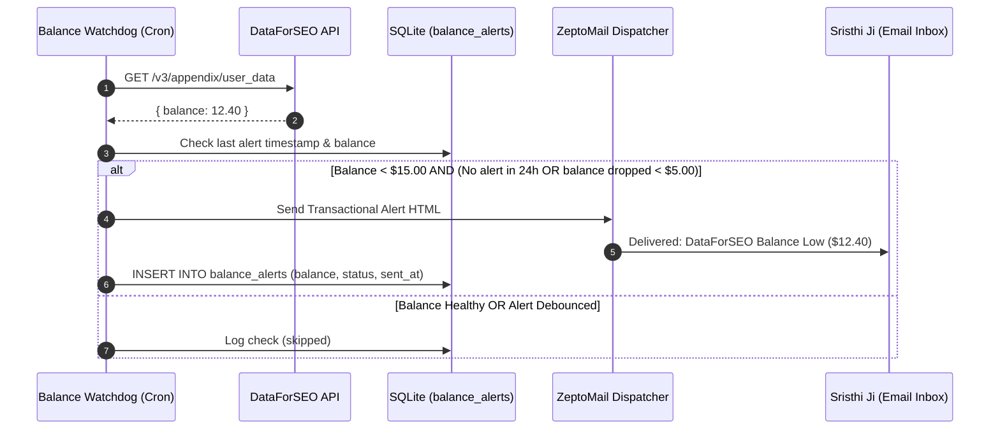

# DataForSEO API Integration & Automated Low-Balance Alert System

This document outlines the API mechanics for DataForSEO Google Maps SERP querying, pre-scan credit estimation, automated balance polling, and the transactional email notification system dedicated to **Sristhi ji**.

---

## 1. DataForSEO Google Maps SERP Integration

LeadSnap utilizes DataForSEO to execute localized Google Maps searches without encountering Google Captchas, IP bans, or mobile proxy overhead.

### 1.1 Endpoint & Payload Specification
* **Live Advanced Endpoint:** `POST https://api.dataforseo.com/v3/serp/google/maps/live/advanced`
* **Authentication:** HTTP Basic Auth (`DATAFORSEO_LOGIN:DATAFORSEO_PASSWORD`)
* **Cost:** ~$0.002 to $0.003 per point query

```json
[
  {
    "keyword": "roof repair",
    "location_coordinate": "17.4485,78.3748,15z",
    "language_code": "en",
    "depth": 20
  }
]
```

### 1.2 Extracted Data Elements
For each item in `result[0].items`:
- `type`: `"maps_search"`
- `rank_group`: Current rank (`1` to `20`)
- `title`: Business Name
- `place_id`: Google Place ID (used for exact target matching)
- `cid`: Customer ID
- `address`: Formatted Address
- `rating.value`: Star Rating (e.g. `4.8`)
- `rating.votes_count`: Review Count
- `category`: Primary Category (e.g. `Roofing Contractor`)
- `url`: Google Maps Listing URL
- `domain`: Official Website URL

---

## 2. Pre-Scan Credit & Cost Estimator (LeadSnap Model)

LeadSnap displays the credit cost to users before they hit "Start Scan".

### Estimation Formula:
$$\text{Credits Consumed} = \text{Total Grid Points} \times \text{Number of Keywords}$$
$$\text{Estimated Cost (USD)} = \text{Credits Consumed} \times \$0.0025$$

### Grid Dimension Presets & Costs:
| Grid Dimensions | Shape | Total Points | 1 Keyword Cost | 5 Keywords Cost |
| :--- | :--- | :---: | :---: | :---: |
| **5 × 5** | Square | 25 | ~$0.06 | ~$0.31 |
| **7 × 7** | Circle | 37 | ~$0.09 | ~$0.46 |
| **7 × 7** | Square | 49 | ~$0.12 | ~$0.61 |
| **9 × 9** | Circle | 61 | ~$0.15 | ~$0.76 |
| **9 × 9** | Square | 81 | ~$0.20 | ~$1.01 |
| **13 × 13** | Circle | 129 | ~$0.32 | ~$1.61 |
| **13 × 13** | Square | 169 | ~$0.42 | ~$2.11 |

---

## 3. Automated Low Balance Alert for Sristhi Ji

### 3.1 Balance Polling Mechanism
* **Endpoint:** `GET https://api.dataforseo.com/v3/appendix/user_data`
* **Cost:** **$0.00** (Free API call)
* **Execution Interval:** Every 4 hours via automated cron worker (`src/lib/balanceWatchdog.ts`), plus an on-demand check before every batch scan.
* **Extraction Path:**
  ```ts
  const balance = response.data.tasks[0].result[0].money.balance;
  ```

### 3.2 Alert Conditions & Debounce
* **Low Balance Threshold:** `$15.00 USD` (configurable via `DATAFORSEO_MIN_BALANCE_USD`).
* **Debounce Window:** 24 hours (once an alert is sent, further alerts are suppressed for 24h unless balance drops further below `$5.00 USD`).
* **Recipient:** Sristhi ji (configurable via `SRISTHI_EMAIL` or `DATAFORSEO_ALERT_EMAIL`, default: `srishti@digitalmojo.in` / `sristhi@digitalmojo.in`).

### 3.3 Transactional Email Template

**Subject:** `URGENT: DataForSEO Balance Low ($<BALANCE>) — Top-Up Required for MojoMap`

```html
<!DOCTYPE html>
<html>
<head>
  <style>
    body { font-family: -apple-system, BlinkMacSystemFont, 'Segoe UI', Roboto, Helvetica, Arial, sans-serif; background-color: #f8fafc; margin: 0; padding: 24px; }
    .card { max-width: 560px; margin: 0 auto; background: #ffffff; border-radius: 12px; border: 1px solid #e2e8f0; overflow: hidden; box-shadow: 0 4px 16px rgba(0,0,0,0.06); }
    .header { background: #0f172a; padding: 24px; text-align: center; }
    .logo { color: #ffffff; font-size: 20px; font-weight: 700; letter-spacing: -0.5px; }
    .badge { display: inline-block; background: #ef4444; color: #ffffff; font-size: 11px; font-weight: 700; padding: 4px 10px; border-radius: 999px; text-transform: uppercase; margin-top: 8px; }
    .body { padding: 32px 28px; color: #1e293b; font-size: 15px; line-height: 1.6; }
    .balance-box { background: #fef2f2; border: 1px solid #fecaca; border-radius: 8px; padding: 18px; text-align: center; margin: 20px 0; }
    .balance-num { font-size: 32px; font-weight: 800; color: #dc2626; font-family: monospace; }
    .btn { display: inline-block; background: #2563eb; color: #ffffff !important; font-weight: 600; text-decoration: none; padding: 14px 28px; border-radius: 8px; margin: 20px 0; text-align: center; }
    .footer { background: #f1f5f9; padding: 16px 24px; font-size: 12px; color: #64748b; text-align: center; border-top: 1px solid #e2e8f0; }
  </style>
</head>
<body>
  <div class="card">
    <div class="header">
      <div class="logo">MojoMap · Rank Intelligence</div>
      <div class="badge">Critical Balance Notice</div>
    </div>
    <div class="body">
      <p>Hello <strong>Sristhi Ji</strong>,</p>
      <p>This is an automated notification from <strong>MojoMap</strong>. The shared <strong>DataForSEO</strong> account balance has dropped below the critical operating threshold of <strong>$15.00</strong>.</p>
      
      <div class="balance-box">
        <div style="font-size: 13px; color: #7f1d1d; font-weight: 600; text-transform: uppercase;">Current Live Balance</div>
        <div class="balance-num">$12.40 USD</div>
        <div style="font-size: 12px; color: #991b1b; margin-top: 4px;">Approx. 80-100 scan points remaining before automated pause</div>
      </div>

      <p>To avoid failure or interruption of scheduled client GBP geo-grid scans, please top up the account balance:</p>

      <div style="text-align: center;">
        <a href="https://app.dataforseo.com/financial/balance" class="btn" target="_blank">Top-Up DataForSEO Balance &rarr;</a>
      </div>

      <p style="font-size: 13px; color: #64748b;">
        Direct payment dashboard URL:<br>
        <a href="https://app.dataforseo.com/financial/balance" style="color: #2563eb;">https://app.dataforseo.com/financial/balance</a>
      </p>
    </div>
    <div class="footer">
      Digital Mojo Automated Operations · MojoMap System Watchdog
    </div>
  </div>
</body>
</html>
```

### 3.4 Integration Workflow

